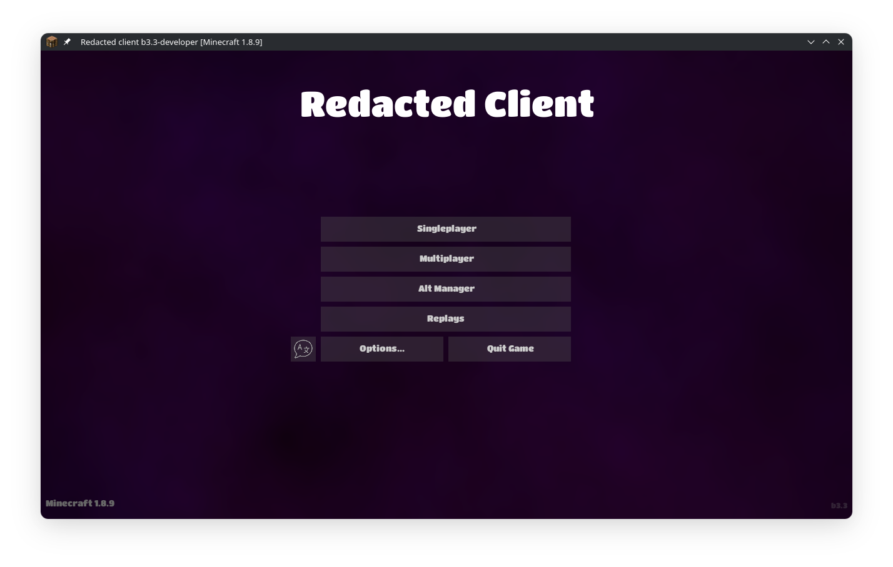

# Redacted
Final version: b3.3-developer

Redacted was a Minecraft 1.8.9 client with aimed at Polar-AC and Hypixel. It's discontinued. The source is out as-is: no support, no updates, no promises. In the dicontinuation of this client an initial developer test client by the name of ColdPlay was made; https://github.com/Un-kn-0W-n/ColdPlay ColdPlay, no doubt, has superior bypasses. There may be a new client in works which is set to be clean, modern, and well designed from the ground up. (Human-made)



## Modules

Combat: AimAssist, SilentAim, SilentAura, AutoClicker, AutoBlock, AutoThrow, BackTrack, BedAura (with a Hypixel mode), BowAimAssist, Criticals, FakeLag, NoHitDelay, Reach, TargetFilter, Team, Triggerbot, Velocity, WTap, AntiBot, AntiFireBall, AntiMiss.

Movement: Sprint, NoSlow, NoFall, NoJumpDelay, KeepSprint, InventoryMove, BridgeAssist.

Render: EntityESP (ESP, tracers, nametags, target HUD), BlockESP (beds, chests, item counts, place effect), Crosshair, FullBright, Freecam, FreeLook, Mirror, Notifications, SuperheroFX, TNTTimer, Trajectories, Tweaks, ClickGUI, EntityCulling, ParticleCulling.

World: Scaffold, BedProtection, ChestStealer, Clutch, FastPlace, AutoPearl, Baritone.

Utility: AutoHeal, AutoTool, InvManager, AnticheatDetector, FlagDetector, MiddleClickFriend, ClientSpoof.

Cosmetics: Capes, Hats, Wings, Particles, HitSounds.

Exploit: Disabler.

Developer: PacketLogger, with its own packet log GUI.

## Anticheat work

Reach with modes to bypass on Grim, Polar and Vulcan. WTap is tuned around Polar-class reaction offsets. BedAura has a Hypixel adjacent-then-bed break mode. AnticheatDetector fingerprints Polar, Intave and AGC by transaction timing and windowId patterns, and FlagDetector watches setbacks, velocity and transactions live.

## GUIs

Three click GUI styles: Dropdown, Exhibition (Incomplete...) and Redacted. Opens with Right-Shift. There's also a drag-and-drop HUD editor (positions survive resizes), a theme manager, a config manager, an alt manager, a Bed Wars team manager and the packet log viewer.

## Alt manager

Cracked, Microsoft (device code flow and refresh tokens) and Altening accounts. Per-alt proxy support, a history of every session, and auto login of the last used account on startup.

## Replays

ReplayMod is built in. Recording, replay and rewind work, and the viewer opens from the main menu. Ported fully to out 1.8.9 MCP base.

## Baritone

The full Baritone pathing source ships with the client, plus a bridge that routes Baritone's rotations through the client's silent aim and an auto bridge controller for bridging. This was done in an effort to make smoother rotations to bypass anticheats. Results vary.

## Commands

Prefix is `.`:

`.help`, `.toggle <module>`, `.config`, `.theme`, `.mcp`, `.packetlog`, `.anticheat`, `.reset`, `.settimer`.

## MCP bridge

`.mcp on` starts it on port 25585, `.mcp off` stops it and `.mcp status` shows what's running. It binds to 127.0.0.1 and exposes modules, configs, client info, baritone, world, player, containers, render, chat and debug tools. It also starts with the client by default; flip `AUTO_START_MCP` in `DebugSystem` if you don't want that. Just give the link to the MCP to an AI agent and it can do a lot of things such as controlling baritone, the module system (including configuring settings) and getting world data to produce movements. This was done in an effort to perhaps recreate something similar to "Zeroday killbots" (discontinued client by Nefarious Intent)

## Debug

`./gradlew debugRunClient` puts the packet dumper on the classpath (set `DEBUG_PACKETS=true` to turn it on). The rest of the debug logging lives in `DebugSystem`: per-category flags, one file per category under `logs/debug-<category>.log`.

## Under the hood performance tweaks

LWJGL 3 instead of the 1.8.9's vanilla LWJGL 2 stack, a Celeritas/Sodium-style chunk renderer for 1.8.9.

## Building

JDK 21 is all you need; the Gradle toolchain and wrapper handle the rest.

```bash
./gradlew runClient
```

If `run/assets` doesn't exist yet, point it at a normal 1.8.9 install once:

```bash
cp -R ~/.minecraft/assets run/assets
```

Standalone jar:

```bash
./gradlew shadowJar        # build/libs/RedactedClient.jar
```

IntelliJ imports it as a Gradle project without setup beyond picking the JDK.

## License

GPL v3. See `LICENSE`.
